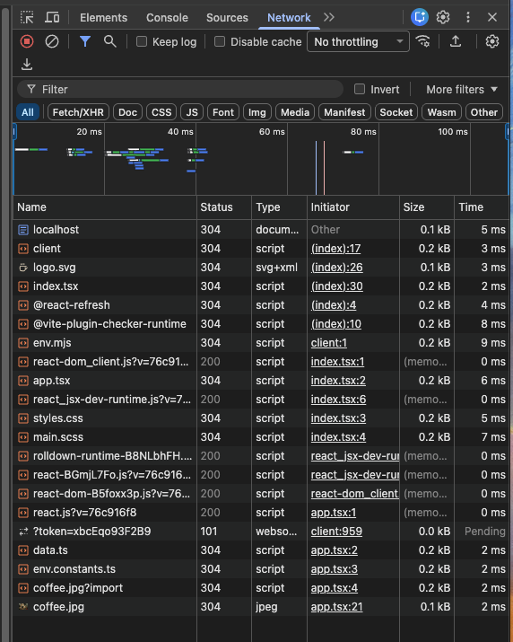
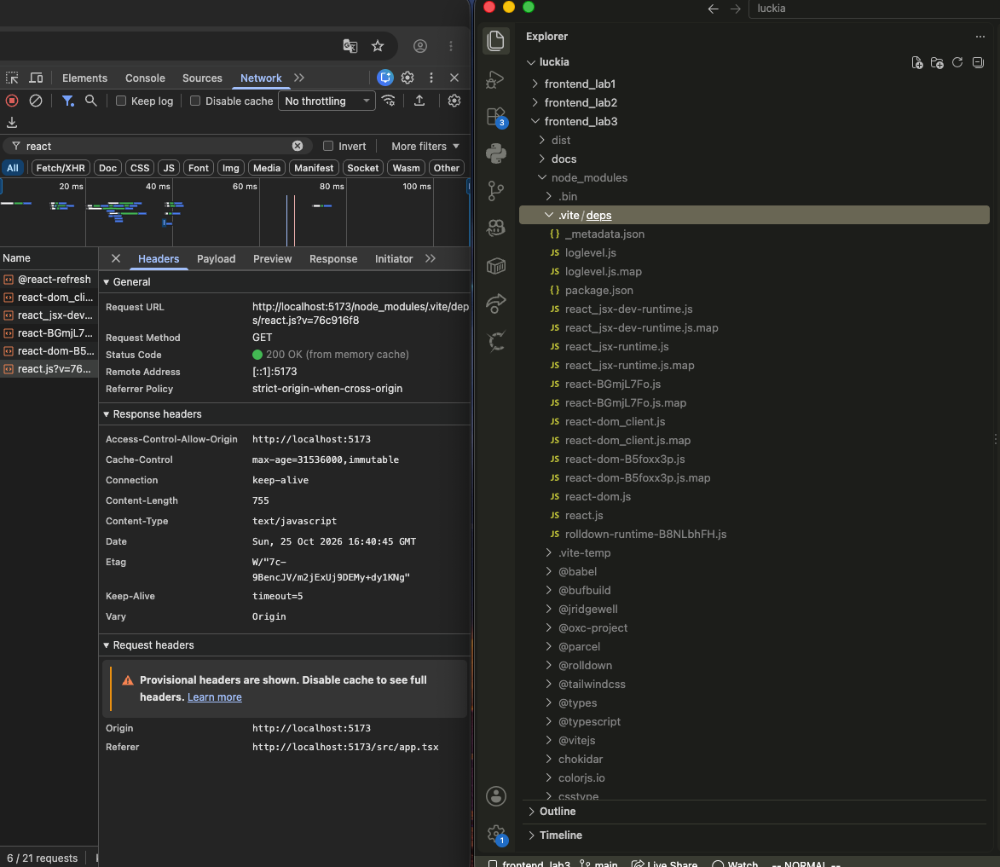
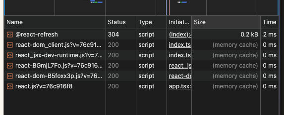
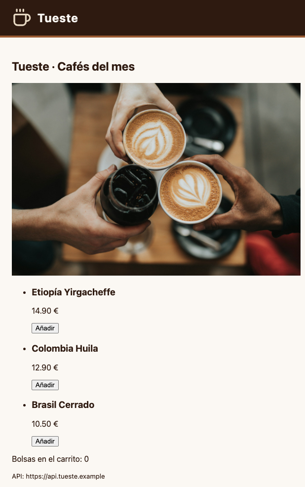
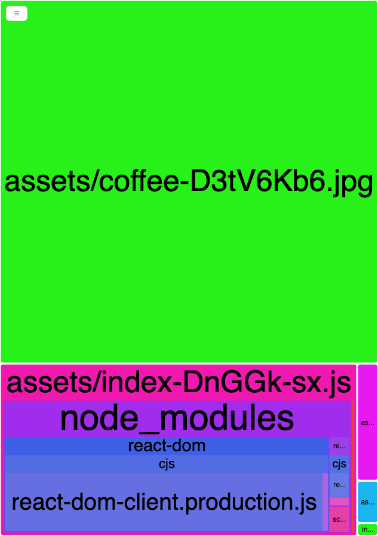

# ☕ Tueste · Laboratorio del módulo 3 (bundling con Vite)

La tienda de Tueste montada a mano con Vite, sin `npm create vite`: empieza con un `package.json` vacío y termina con TypeScript, React, Sass, Tailwind, variables de entorno y code splitting. Cada obligatorio tiene su propio commit (`git log --oneline`).

Versiones: Node 22.17, Vite 8.3 (Rolldown + Oxc), TypeScript 7.0, React 19.3, Tailwind CSS 4.3.

## 🚀 Cómo arrancarlo

```bash
npm install
npm start
```

| Script            | Comando        | Para qué sirve                                                                                                                                       |
| ----------------- | -------------- | ---------------------------------------------------------------------------------------------------------------------------------------------------- |
| `npm start`       | `vite`         | Servidor de desarrollo en `http://localhost:5173`. Sirve el código como módulos ES nativos, sin empaquetar, con HMR. Carga `.env`.                     |
| `npm run build`   | `vite build`   | Build de producción en `dist/`: empaquetado con Rolldown, minificado y con hash en el nombre de los ficheros. Carga `.env` y `.env.production`.         |
| `npm run preview` | `vite preview` | Sirve la carpeta `dist` tal cual en `http://localhost:4173`, para probar la versión de producción en local. No compila nada: antes hay que hacer `build`. |

> El `.npmrc` del repo apunta al registro público de npm: en mi máquina el registro global es uno corporativo que no da acceso a estos paquetes.

## ✅ Checklist

### Obligatorios

- [x] 1 · Proyecto desde cero
- [x] 2 · Estilos con Sass
- [x] 3 · Imágenes
- [x] 4 · TypeScript con comprobación de tipos
- [x] 5 · React
- [x] 6 · Variables de entorno
- [x] 7 · README + bitácora de IA

### Opcionales

- [x] Opcional 1 · Tailwind
- [x] Opcional 2 · Code splitting y análisis del bundle

## 📦 Salida final de `npm run build`

```text
vite v8.3.5 building client environment for production...
✓ 24 modules transformed.
dist/index.html                     0.99 kB │ gzip:  0.54 kB
dist/assets/coffee-D3tV6Kb6.jpg   492.95 kB
dist/assets/index-CJEd8YF1.css      8.73 kB │ gzip:  2.57 kB
dist/assets/shipping-Cc8dH3--.js    0.18 kB │ gzip:  0.17 kB │ map:     0.42 kB
dist/assets/cart-CI14VVZ1.js        0.19 kB │ gzip:  0.17 kB │ map:     0.52 kB
dist/assets/loglevel-CUEpsZvd.js    3.23 kB │ gzip:  1.38 kB │ map:    16.59 kB
dist/assets/index-DnGGk-sx.js     223.49 kB │ gzip: 70.33 kB │ map: 1,048.08 kB
✓ built in 565ms
7 chunks of 711.02 KB (gzip: 551.78 KB | map: 1.02 MB)
```

Los `map` aparecen porque el analizador activa los sourcemaps para poder medir cada módulo.

## 📝 Respuestas

### 1 · Proyecto desde cero

**¿Para qué sirve el hash del nombre del fichero en producción? ¿Qué pasaría sin él cuando subís una versión nueva?**

Es *cache busting*. El hash se calcula a partir del contenido, así que el nombre sólo cambia si cambia el fichero. Por eso el servidor puede decir al navegador que lo guarde en caché mucho tiempo. Sin hash, la versión nueva se seguiría llamando `index.js`, y el navegador (o una CDN) serviría la versión vieja que tiene en caché hasta que caducase. Además, un usuario podría acabar con el HTML nuevo y el JS viejo. Con hash, el `index.html` nuevo apunta a `index-<hash nuevo>.js`, que el navegador no tiene, y lo descarga.

**¿Qué diferencia hay entre `npm start` y `npm run preview`? ¿Cuál usaríais para comprobar que la versión de producción funciona?**

`npm start` es el servidor de desarrollo: no empaqueta, transforma cada fichero cuando el navegador lo pide y lo sirve como módulo ES nativo, con HMR, `304` y `?t=`. `npm run preview` no transforma nada: sirve el resultado de `npm run build` (la carpeta `dist`), igual que lo haría un servidor estático en producción. Para comprobar la versión de producción, `build` + `preview`: es lo que de verdad se va a subir, con los valores de `.env.production`.



### 2 · Estilos con Sass

**¿Por qué en desarrollo el CSS llega como un módulo de JavaScript y en producción como un fichero `.css`?**

En desarrollo lo importamos desde JS (`import "./styles/main.scss"`), y el navegador sólo sabe importar JavaScript. Vite responde con un módulo JS que mete el CSS en un `<style>` del `<head>` con `updateStyle` y que, con HMR, lo cambia sin recargar la página (`removeStyle` quita el anterior). En producción lo importante es la velocidad de carga: un `.css` normal, minificado y con hash, enlazado con `<link>`. El navegador lo descarga en paralelo y lo cachea, y no hace falta ejecutar JS para tener estilos.

### 3 · Imágenes

**¿Dónde ha ido a parar el logo y por qué Vite lo trata distinto que la foto? ¿Qué ganamos y qué perdemos con eso?**

Está dentro del propio `dist/index.html`, como `src="data:image/svg+xml,..."`. Vite convierte en *data URI* los assets que ocupan menos de `build.assetsInlineLimit` (4 KB por defecto). El logo ocupa 338 bytes y la foto, 493 KB, así que la foto sale como fichero aparte: `dist/assets/coffee-<hash>.jpg`. Ganamos una petición HTTP menos para un fichero diminuto. Perdemos la caché independiente: el logo va dentro del HTML (o del JS), se vuelve a descargar cada vez que cambia ese fichero y lo hace más pesado. Por eso sólo tiene sentido con ficheros pequeños.

### 4 · TypeScript

**¿Por qué Vite, por sí solo, no comprueba los tipos? ¿Qué gana con ello?**

Vite transpila TypeScript con Oxc, que trabaja fichero a fichero: quita las anotaciones de tipos y ya está. No construye el sistema de tipos de todo el proyecto como hace `tsc`. Por eso exige `isolatedModules`, que avisa del código que no se puede transformar mirando sólo un fichero. Gana velocidad: transformar un fichero tarda milisegundos, tanto al arrancar como en cada cambio. La comprobación de tipos la hace aparte `vite-plugin-checker`, en otro hilo, sin frenar al servidor (y en `build`, haciéndolo fallar si hay errores).

### 5 · React

**¿Por qué Vite trata distinto a `react` (dependencia) y a `app.tsx` (vuestro código)? ¿Qué es el pre-bundling y qué problema resuelve?**

Las dependencias casi nunca cambian y nuestro código cambia a cada momento. Al arrancar, Vite hace un *pre-bundling* de las dependencias con Rolldown y lo deja en `node_modules/.vite/deps`. Así resuelve dos problemas: convierte los paquetes de CommonJS (React lo es) a módulos ES, y junta en un fichero los cientos de módulos internos que tiene un paquete, para que el navegador no haga cientos de peticiones. Como sólo cambian si actualizamos la versión, se sirven con `?v=<hash>` y `Cache-Control: max-age=31536000, immutable`: al pulsar F5 salen de la caché del navegador sin llegar al servidor (en mi captura, *from memory cache*, porque recargué la misma pestaña; tras cerrarla y abrirla salen *from disk cache*: en los dos casos no hay petición). `app.tsx` se transforma cuando se pide y se valida con `304` en cada recarga, porque puede haber cambiado.





**¿Qué aporta exactamente `@vitejs/plugin-react` si el JSX ya funcionaba sin él?**

El JSX lo transforma Oxc de serie. El plugin añade **Fast Refresh**, el HMR específico de React: inyecta en cada componente el código que registra sus versiones con el runtime de React, para que al guardar se cambie sólo el componente y se conserve su estado. Sin él, Vite no sabe actualizar `app.tsx` en caliente y recarga la página entera (el carrito vuelve a 0). Con él, cambia el título y el carrito sigue con sus 3 bolsas.

### 6 · Variables de entorno

**¿Por qué Vite obliga a usar el prefijo `VITE_`?**

Para no filtrar al navegador variables que no son para él. Vite mete en el JS todo lo que expone, y en el entorno hay de todo: `PATH`, `HOME`, `USER`, claves del servidor de CI… Con el prefijo, exponerla es una decisión explícita. Sin él (`SHOP_NAME`), `import.meta.env` sólo tenía `BASE_URL`, `DEV`, `MODE`, `PROD` y `SSR`.

**Si mañana cambia la URL de la API de producción, ¿basta con editar `.env.production` en el servidor? ¿Por qué nunca debe ir una clave secreta en una variable `VITE_`?**

No basta. Los valores se escriben en el JavaScript en el momento del `build` (`api.tueste.example` aparece tal cual en `dist/assets/index-<hash>.js`), así que hay que volver a construir y desplegar. El `.env.production` no se lee al servir la web. Por el mismo motivo, una clave en una `VITE_` acaba en un fichero público que cualquiera puede descargar y leer en DevTools: en el front no hay secretos.

**Según la comprobación 5: ¿un feature flag desactivado sirve para "esconder" algo a los usuarios?**

No. Con `VITE_SHOW_OFFERS=false`, el bundle tiene `SHOW_OFFERS:!1` y, justo al lado, `f.SHOW_OFFERS&&(0,h.jsx)("p",{…children:"Envío gratis este mes"})`. El banner no se pinta, pero el texto está ahí para quien lo busque. Un flag sirve para activar o desactivar funcionalidades, no para ocultar información: lo que no deba ver el usuario no puede llegar al front.



### Opcional 1 · Tailwind

**Tailwind tiene miles de clases. ¿Cómo sabe cuáles meter en el CSS final?**

No tiene las clases escritas en ningún sitio: las genera. El plugin `@tailwindcss/vite` recorre los ficheros del proyecto (todos los que no ignora `.gitignore`, también el `README.md`) buscando palabras que puedan ser una clase, y sólo genera el CSS de las que existen de verdad. Por eso `sm:grid-cols-3` está en `dist/assets/index-<hash>.css` y la clase rosa del enunciado no. Lo comprobé sin querer: en un primer borrador de este README escribí el nombre de la clase sin el `sm:`, y apareció en el CSS una regla que la página no usa. Por eso aquí sólo nombro clases que de verdad uso. Un efecto que vi: el *Preflight* de Tailwind pone los títulos con `font-weight: inherit` y el `h1` de la cabecera perdió la negrita. Lo arreglé en el propio Sass (`font-weight: bold`), y las reglas de `.brand-header` acaban en el mismo fichero CSS.

### Opcional 2 · Code splitting y análisis del bundle

**Cambiad uno de los dos a un `import` normal al principio de `app.tsx` y volved a construir. ¿Qué pasa con su chunk? ¿Por qué?**

Al importar `shipping` de forma estática, `shipping-<hash>.js` desaparece del build y su código pasa a `index-<hash>.js`. Con un `import` estático, el módulo es necesario para ejecutar `app.tsx`, así que tiene que llegar con el chunk principal. Sólo `import()` crea un punto de corte que se puede cargar más tarde. Después lo dejé otra vez con `import()`.

**En un proyecto real, ¿qué partes de una tienda cargaríais así?**

Lo que no hace falta para la primera pantalla: el proceso de pago (checkout, pasarela, validación de formularios), el panel de la cuenta del cliente, cada página con el router (*lazy routes*), un mapa de tiendas, un editor de reseñas o un visor de imágenes en grande.

**¿Qué es lo que más ocupa del chunk principal?**

`react-dom` (`react-dom-client.production.js`), muy por delante de todo lo demás. Nuestro código (`app.tsx`, `data.ts`, `env.constants.ts`) apenas se ve. Fuera de los chunks JS, lo más grande es la foto.



**¿Por qué Vite saca `loglevel` a un fichero aparte en lugar de copiarlo dentro de cada chunk?**

Porque lo usan dos chunks (`cart` y `shipping`). Si lo copiara en los dos, el usuario descargaría el mismo código dos veces y habría dos instancias distintas de la librería. Como chunk compartido se descarga una sola vez, se cachea, y los dos chunks lo importan. Al pulsar "Calcular total" se descargan tres ficheros: `cart`, `shipping` y `loglevel`.

## 🗂️ Qué hay en el repositorio

- `.env` y `.env.production` **sí** están en el repo: sólo tienen valores públicos (nombre, URL de la API y un flag), que acaban igualmente en el JS. `.env.local` y `.env.*.local` están en `.gitignore`: son para valores de cada máquina.
- `node_modules` y `dist` no se suben. El informe del analizador se genera en `dist/bundle-report.html`. En un proyecto real activaría el analizador sólo cuando lo necesite.

## 🤖 Bitácora de IA

**Herramienta:** Claude Code (Claude Opus 5.5), trabajando dentro de mi carpeta del curso: con acceso a los apuntes del módulo (`luckia-front-end-moderno-ia/03-bundling/`), a mis laboratorios 1 y 2 y a un Chrome con DevTools.

### Cómo trabajé

1. **Un prompt principal para montar el laboratorio.** Le pasé el enunciado completo y le pedí que lo implementara tal como pide, aplicando la teoría del módulo, y que después me explicara cada paso con la teoría que hay detrás.
2. **La IA lo montó paso a paso, comprobando cada uno.** Antes de escribir código leyó los README de los pasos del módulo (`01-basic` … `11-bundle-analyzer`) y mis laboratorios anteriores: de ahí salen los colores de marca, el icono del logo y el `.npmrc`. Después fue obligatorio por obligatorio, con un commit cada uno. En cada paso hizo las comprobaciones del enunciado en un Chrome real: peticiones en Network, consola, el `<style>` del `<head>`, el HMR con y sin `@vitejs/plugin-react` y el contenido de `dist`. Por ejemplo, para ver que el CSS cambia sin recargar, guardó una marca en `window`, cambió un color de `_variables.scss` y comprobó que la marca seguía ahí.
3. **Me lo explicó paso a paso**, relacionando cada comprobación con su apartado de la teoría: pre-bundling, Oxc e `isolatedModules`, variables sustituidas en el build…
4. **Lo revisé y pregunté lo que no entendía** (las tres últimas entradas). Las capturas de DevTools las hice yo: la IA puede leer las peticiones y sus cabeceras, pero no capturar el panel de DevTools.

### El prompt principal

#### Prompt

"im going to implement the third module laboratory. check the luckia-front-end-moderno-ia dir for the theory contents, which are the ones i have to apply, and both frontend_lab1 and 2 to get the previous code of the course which the laboratory refers to. i will paste you the statement, and i want you to implement all it asks for, in the way it asks for it applying the theory. then you will walk me through each step, explaining to me the theory in the luckia-front-end-moderno-ia behind that particular step." (y, a continuación, el enunciado entero).

#### Qué me dio

Los obligatorios 1 a 7 y los dos opcionales, con un commit por paso y subidos a GitHub, más una explicación de cada paso con la teoría del módulo. Por el camino aparecieron tres problemas, que van en las tres entradas siguientes.

#### Qué corregí y por qué

Le pedí que lo hiciera con la teoría del módulo como referencia y no de memoria, porque la IA mezcla versiones: `@use` y no `@import` en Sass, Tailwind v4 sin `tailwind.config.js`, `/// <reference types>` y no `path`. Revisé que la configuración no tuviera opciones de más. Por ejemplo, no está `modulePreload: { polyfill: false }`: en la teoría es opcional y el enunciado puntúa no añadir lo que no hace falta.

### Dentro del prompt principal: npm devolvía 403

#### Prompt

El obligatorio 1 del prompt principal: `npm init -y` e instalar Vite.

#### Qué me dio

El `npm install` falló con `403 Forbidden`: npm usaba el registro corporativo configurado en mi `~/.npmrc`, que no da acceso a estos paquetes.

#### Qué corregí y por qué

Se añadió un `.npmrc` en el proyecto con `registry=https://registry.npmjs.org/`, igual que en el laboratorio 2. Así el proyecto instala del registro público sin tocar la configuración global de la máquina.

### Dentro del prompt principal: la foto pesaba poco

#### Prompt

El obligatorio 3: "Una foto de café en JPG, de varios cientos de KB (Unsplash o Pexels)".

#### Qué me dio

Una foto de Unsplash a 1600 px de ancho, de 213 KB.

#### Qué corregí y por qué

Se pidió a 2400 px (493 KB). Con una foto así se ve claro el contraste con el logo: la foto sale como fichero aparte y el logo, de 338 bytes, se queda en línea por `assetsInlineLimit`.

### Dentro del prompt principal: Tailwind y la cabecera

#### Prompt

El opcional 1: Tailwind con `@tailwindcss/vite`, `styles.css` importado antes de `main.scss` y el catálogo en rejilla, con la cabecera en Sass.

#### Qué me dio

El catálogo con Tailwind funcionaba, pero en la captura el título "Tueste" de la cabecera había perdido la negrita. Además, al escribir este README apareció en el CSS una regla que la página no usa.

#### Qué corregí y por qué

- El *Preflight* de Tailwind resetea los títulos (`font-weight: inherit`), y el `.brand-header h1` de Sass no fijaba el peso. Se añadió `font-weight: bold` en `main.scss`, sin tocar el orden de los imports.
- Tailwind también lee el `README.md`: nombrar aquí una clase que no uso la mete en el CSS. Se reescribió el texto para nombrar sólo clases que sí uso, y se comprobó que el CSS sale igual con y sin README.
